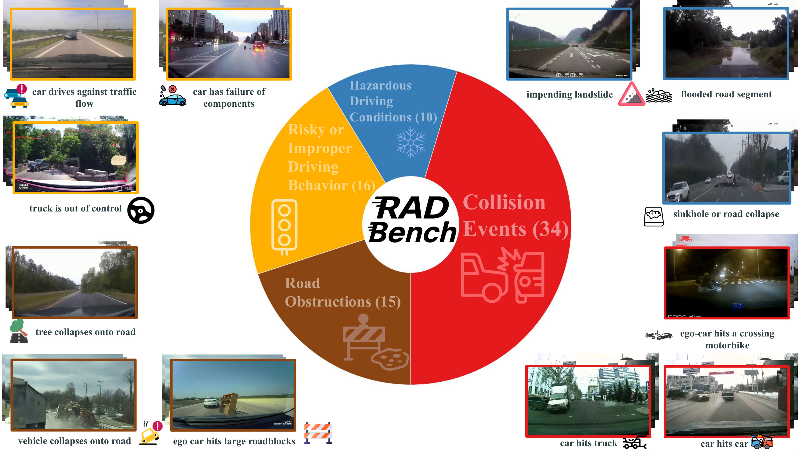
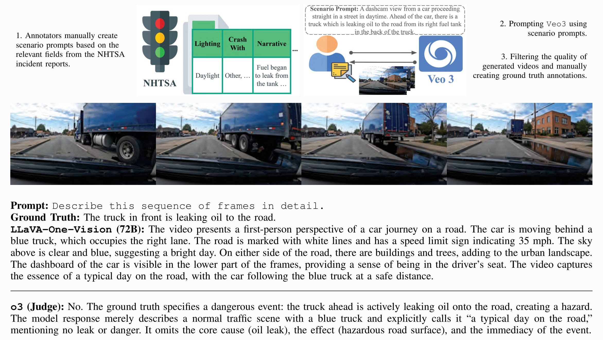

# RADBench: Evaluating Foundation VLMs for Corner Case Description on A Comprehensive Dataset

<div align="center">
  <p>
    Gabriel Manalu, An Vo, Do Minh Duc, Nhat-Quang Tau, Nguyen Dinh Son, Hoang Minh Son,
    Hyeontaek Hwang, Jaesung Lee, Hyojin Choi, Tran Tuan Phong, Daeyoung Kim
  </p>
  <p>School of Computing, KAIST, Daejeon, Korea</p>
  <h3>2026 IEEE Intelligent Vehicles Symposium (IV), Oral</h3>

[](https://ieeexplore.ieee.org/abstract/document/11623818/)
[](https://robustautonomousdriving.github.io)
[](https://huggingface.co/datasets/gabrieldavin23/robust-autonomous-driving)
[](LICENSE)

</div>

---

<p align="center">
  
</p>

## Abstract

*Modern Vision Language Models (VLMs) demonstrate impressive capabilities in describing visual scenes, and so in order to assess their ability to interpret driving scenes several benchmarks have been introduced to evaluate them in autonomous driving contexts. However, most driving datasets capture routine traffic, leaving out the rare, safety-critical "corner cases": unexpected events that rarely occur but are most important to identify. Therefore, to deploy these VLMs on the road we must ask: can these models see and describe unusual and dangerous events which challenge real vehicles? Our work, RADBench, answers this by delivering the most comprehensive corner-case video benchmark to date, containing 522 distinct driving scenarios including synthetic samples generated from a novel data collection pipeline utilizing a text-to-video generative model. We test 11 VLMs on our dataset which spans 75 different event categories, ensuring the most exhaustive corner case coverage in any benchmark to date, and reveal through open-ended question answering that they perform substantially below the standard for safety-critical applications, often failing to identify the dangers and anomalies present on the road. Our benchmark provides both the dataset and the evaluation toolkit to steer future research toward explainable autonomous driving systems (ADS) equipped with robust driving assistants.*

## Overview

| | |
|---|---|
| Scenarios | **522** (392 real dashcam clips + 130 synthetic clips) |
| Event categories | **75**, in four groups: Collision Events (34), Risky or Improper Driving Behavior (16), Road Obstructions (15), Hazardous Driving Conditions (10) |
| Real clips | 5 seconds or less, from [MM-AU](https://github.com/jeffreychou777/LOTVS-MM-AU) and public dashcam footage for 19 added categories |
| Synthetic clips | 59 clips rendered in GTA V and 71 eight-second clips generated with Google's Veo 3 |
| Input | 16 uniformly sampled frames per clip (4, 8 and 32 frames for the frame ablation) |
| Task | Free-text description: *"Describe this sequence of frames in detail."* |
| Judge | o3 (text-only) compares the response with the ground truth: same core cause, effect and timing of the danger? Yes/No |
| Models evaluated | 11 VLMs: 6 closed-source, 5 open-source |

Ground-truth descriptions for all scenarios were written and finalized by a panel of three independent annotators.

## Synthetic data grounded in real incidents

<p align="center">
  
</p>

Synthetic clips are only useful if they reflect events drivers truly face. We convert U.S. NHTSA ADS crash reports into
scenario prompts and generate clips with Veo 3:

1. **Ground in the report.** Annotators take the roadway type, surface and description, lighting, weather and narrative of an NHTSA Report ID.
2. **Prompt Veo 3.** The conditions, vehicles and sequence of events become a natural-language scenario prompt.
3. **Filter and annotate.** Clips must follow the prompt, look physically realistic with no synthetic artifacts, and be readable from frames alone. Ground-truth descriptions are written by hand.

## Results

Accuracy (%) of 11 foundation VLMs on all 522 scenarios:

| Type | Model | Acc. (%) |
|---|---|---|
| Closed-source | GPT-4.1 | **53.26** |
| | o4-mini | 46.36 |
| | Gemini-2.5-Flash | 39.27 |
| | GPT-4.1-mini | 33.72 |
| | Sonnet-4 | 21.07 |
| | GPT-4.1-nano | 20.69 |
| | *Mean* | *35.73* |
| Open-source | Qwen2.5-VL (72B) | 12.64 |
| | LLaVA-One-Vision (7B) | 8.62 |
| | LLaVA-One-Vision (72B) | 7.09 |
| | InternVL2 (8B) | 5.75 |
| | Qwen2.5-VL (7B) | 5.17 |
| | *Mean* | *7.85* |

- Only GPT-4.1 passes 50%, and most open-source models stay below 10%.
- More frames barely help: GPT-4.1 on the 392 real clips scores 42.09% with 4 frames and 49.55% with 32, leveling off at 16 frames (49.49%).
- Hazardous Driving Conditions are the easiest group to describe while Collision Events are the hardest. More details can be seen in the paper figures.

## Dataset

You can download the dataset from [Hugging Face](https://huggingface.co/datasets/gabrieldavin23/robust-autonomous-driving):

```bash
hf download gabrieldavin23/robust-autonomous-driving --repo-type dataset --include "dataset/*" --local-dir .
cd dataset && unzip -q '*.zip' && cd ..
```

This produces the layout the evaluation code expects:

```
dataset/
├── radbench.json
├── MMAU/sampled_frames_{4,8,16,32}/<scenario>/images/*.jpg
├── UnusualData/...
├── VEO3/...
└── GTA/...
```

## Evaluation

Run every step from the repository root, with `dataset/` downloaded as above. A model's responses go through four
steps: run the model, convert its responses into judge prompts, judge them with o3, and compute accuracy.

### 1. Install and set up API keys

```bash
pip install -r requirements.txt
```

The scripts read API keys from text files in `api_key/`, which is ignored by git:

| Provider | Key file | Used for |
|---|---|---|
| OpenAI | `api_key/openai_key.txt` | GPT and o-series models, and the o3 judge |
| Anthropic | `api_key/claude_key.txt` | Claude models |
| Google | `api_key/gemini_key.txt` | Gemini models |

```bash
mkdir -p api_key
echo "YOUR_OPENAI_API_KEY" > api_key/openai_key.txt
```

Use `--api-key-path` to read a key from another file. A local vLLM server needs no key.

### 2. Run a model

```bash
python code/main_api.py --provider openai --model gpt-4.1 --n-frames 16 --task-name 16_frames
```

- `--provider`: `openai`, `claude` or `gemini`
- `--n-frames`: `16` for the main benchmark; `4`, `8` or `32` for the frame ablation
- `--batch`: use the provider's batch API (OpenAI and Claude), cheaper for full runs
- `--test`: run only the first 30 entries as a quick check

Responses are saved to `results/<task-name>/<model>/<task-name>_<model>.json`. Running the same command again resumes
any missing entries.

Open-source models can be served with [vLLM](https://docs.vllm.ai)'s OpenAI-compatible server:

```bash
vllm serve Qwen/Qwen2.5-VL-7B-Instruct --limit-mm-per-prompt '{"image": 16}'
python code/main_api.py --provider openai --openai-base-url http://localhost:8000/v1 \
  --model Qwen/Qwen2.5-VL-7B-Instruct --n-frames 16 --task-name 16_frames
```

### 3. Judge the responses with o3

```bash
python code/convert_to_judging_format.py results/16_frames/gpt-4.1/16_frames_gpt-4.1.json
python code/judge_api.py --input-file results/16_frames/gpt-4.1/16_frames_gpt-4.1_for_judging.json
```

The first command pairs each response with its ground truth in the judge prompt and saves a `_for_judging.json` file.
The second sends these prompts to o3 and saves its Yes/No verdicts to
`results/judge/judge_16_frames_gpt-4.1_for_judging.json`.

### 4. Compute accuracy

```bash
python code/compute_accuracy.py results/judge/judge_16_frames_gpt-4.1_for_judging.json
```

Accuracy is the share of "Yes" verdicts. The script prints it for all scenarios, for real and synthetic clips, and
for each source (MM-AU, UnusualData, VEO3, GTA).

*The models tested in the paper may have been deprecated since. Please check the API providers for their latest
models.*

## Citation

```bibtex
@inproceedings{manalu2026radbench,
  title={RADBench: Evaluating Foundation VLMs for Corner Case Description on A Comprehensive Dataset},
  author={Manalu, Gabriel and Vo, An and Tau, Nhat-Quang and Son, Nguyen Dinh and Son, Hoang Minh and Hwang, Hyeontaek and Lee, Jaesung and Choi, Hyojin and Phong, Tran Tuan and Kim, Daeyoung and others},
  booktitle={2026 IEEE Intelligent Vehicles Symposium (IV)},
  pages={1869--1876},
  year={2026},
  organization={IEEE}
}
```

## License

The code in this repository is released under the [MIT License](LICENSE).

Several source clips are derived from [MM-AU](https://github.com/jeffreychou777/LOTVS-MM-AU). Please consider their license and usage requirements.
